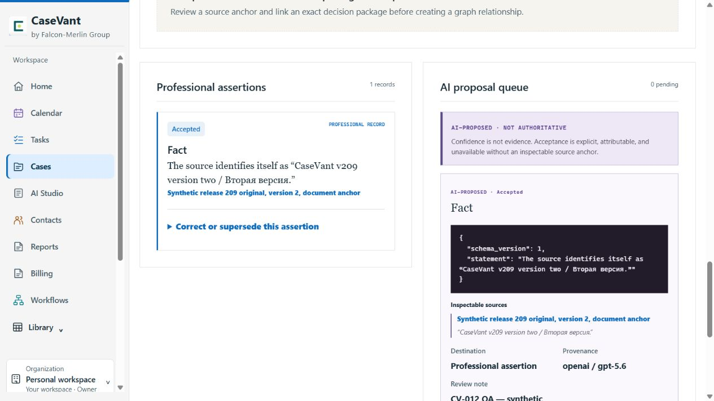
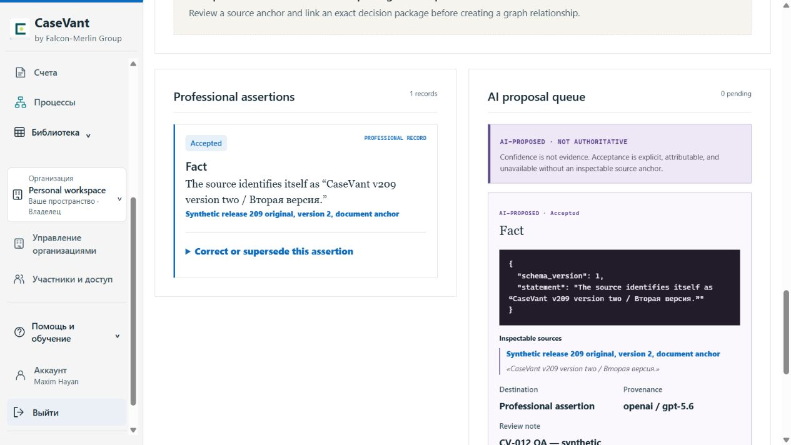
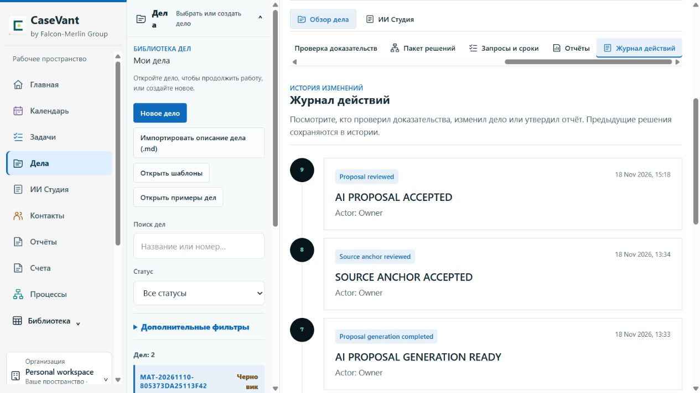

# CV-039 — generated assertion acceptance

## Public v225, 18 November 2026

#320 merged at 13:08:13 UTC after all 18 checks passed. Exact-main `8c7d5649ee74e41c9810ed36cbd62f5e51bc5173` web/PDF run 44310653796 passed on attempt 2: 2,102 tests, zero failures, three inherited skips, two HTML checks and zero vulnerabilities in both audits. Attempt 1 failed because Chrome did not create `DevToolsActivePort` during packaged-browser startup; the unchanged check passed on retry.

Sites v225 published at 13:28:38 UTC from source `1f828ee9ec2a89e3c318ab1e301091ca67ef1b56`, retaining environment revision 42 and public access. Both origins returned the exact runtime. Each initially had one different asset 404 immediately after deployment; full rechecks passed 221/221 on both. [Receipt](receipts/cv012-v225.json).

A fresh signed-in RU tab loaded the existing pending proposal and accepted version-2 source. The authorized bilingual QA note was re-entered in that new tab. Ordinary acceptance now passed the CV-038 payload guard but failed with `Accepted assertion proposals require exactly one statement field.` No proposal decision or assertion was created. CV-012 acceptance is still pending.

## Root cause and repair

Generation writes `{schema_version:1, statement}`; the acceptance route allowed only a legacy string or `{statement}`. The shared assertion-value parser now accepts exactly the generated v1 envelope as well as legacy values. Unsupported versions, extra fields, missing/non-string/empty/NUL/overlong statements still fail. Existing length, trim, authority, source and transaction guards remain unchanged. No migration or rewrite of the historical proposal is needed.

The D1/R2 generation integration test now feeds actual stored fact/date values into the same parser used by the acceptance route. This closes the fixture gap that allowed generation and review tests to pass separately. Additional parser tests cover legacy compatibility and malformed envelopes; route wiring and review guard tests remain active. All 21 focused tests pass; type checking is recorded after completion.

Next: green CI, merge/release, accept the same already source-reviewed synthetic proposal, verify note and attribution through EN/RU switching and reload, and record the resulting assertion separately. Do not regenerate or edit away the envelope to bypass the bug. CV-035 localization, narrow layout acceptance and CV-010/028/029 active-client checks remain open.

## Public v226 — live acceptance

#321 merged at 14:06:35 UTC with all 18 checks passing. Android run 44315257564 initially failed on Maven Central HTTP 429 responses for Kotlin dependencies; the unchanged retry passed. Local type checking passed after explicit JSON fixture typing. Exact-main web/PDF run 44320671861 passed on its first attempt: 2,104 tests, zero failures, three inherited skips, two HTML checks and both dependency audits clean.

Sites v226 published at 14:17:54 UTC, canonical `1c33529a23f26017fc9d6efcd35157c03c9c3b2a`, Sites source `2242974054e968321f9c778a61f2c07e74acb626`, environment revision 42. Both origins return the exact runtime and verify 221 assets. The platform origin passed immediately; the custom domain had one initial propagation miss and passed a full recheck. [Receipt](receipts/cv012-v226.json).

The fresh signed-in owner tab accepted the existing proposal without editing or regeneration. The stored decision at `2026-11-18T14:18:45.226Z` belongs to the owner actor and preserves the bilingual QA note. It created accepted professional assertion `assertion_70f91703a9e74c7880cbc873d514b62a` from proposal `proposal_28e6ff23bf004da6922ee778f8bc2187`, citing the same exact version-2 anchor. The UI shows one professional record, zero pending proposals, and the original accepted proposal with its provider and note. The statement only describes the synthetic fixture's label; no legal conclusion was introduced.

RU→EN→RU switching and reload separately in EN and RU retained the same accepted proposal, assertion, note and citation. The source link focused the exact accepted citation. Audit shows proposal acceptance after source acceptance; read-only storage inspection confirms reviewer actor, timestamp and accepted-object identity. No invitation, source replacement, second generated proposal or duplicate decision was created.

CV-034/036/038/039 are production-verified. CV-037's accepted-source enablement is live; its unavailable-source states have integrated local coverage, not a new live mutation. CV-035 remains open: Evidence/audit labels and notices are partly English in RU. CV-040 records narrow review-note columns and raw-JSON presentation with the case picker expanded. Mobile layout acceptance remains pending. Active-client CV-010/028/029 and broader live stale/denied-access scenarios were not exercised. Documentation-only closure does not require another runtime deployment.
